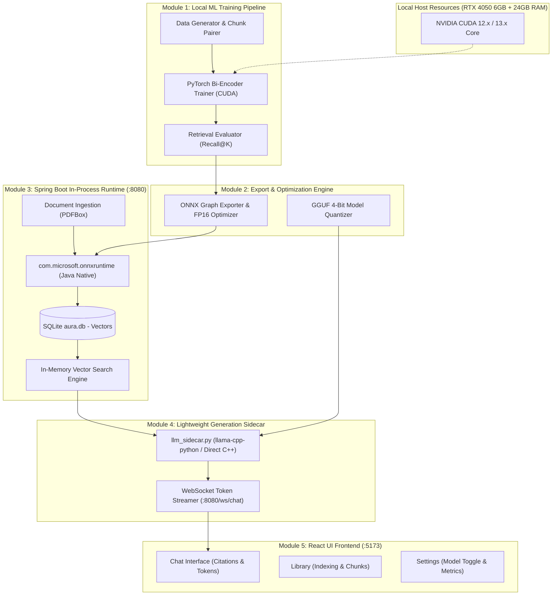

# 🏗️ AURA Independent ML System: Architecture & Context

## Executive Summary
This document establishes the architectural context and specification for transitioning **AURA (AI Unified Retrieval Assistant)** from an external **Ollama-dependent runtime** to an **in-process, 100% self-contained local ML architecture**. 

Training, quantization, and evaluation execute locally on the host's **NVIDIA GeForce RTX 4050 GPU (6 GB VRAM)** and **AMD Ryzen 7 7435HS (24 GB RAM)**, eliminating external software installations, internet dependencies, and per-token cloud costs.

---

## 1. System Architecture & Component Mapping

---

## 2. Page & Module Inventory

### Total Count:
- **Frontend Pages/Views:** 4 Active Views
- **Backend & ML Modules:** 5 Core Modules

---

### Page-by-Page Specifications

#### 1. `/chat` — Multimodal Chat & Retrieval View
- **Architectural Rationale:** Primary operational workspace for asking questions across ingested documents, audio files, and images.
- **Granular Features:**
  - Real-time token streaming via `/ws/chat`.
  - Inline grounded citation cards showing exact file name, page number, and source passage.
  - Model status badge displaying `AURA-Native (ONNX + RTX 4050)` with active inference latency in milliseconds.
  - Chat history session persistence in SQLite.

#### 2. `/library` — Document & Media Ingestion Hub
- **Architectural Rationale:** Centralizes upload, preprocessing, parsing, and vector indexing for multi-format inputs (PDF, DOCX, TXT, WAV, MP3, PNG, JPG).
- **Granular Features:**
  - File drag-and-drop with client-side mime validation.
  - Live indexing progress bar with real-time vectorization status.
  - Vector chunk preview drawer inspecting raw text chunks and their calculated 384-dim vector norm.
  - Delete and re-index controls per document.

#### 3. `/history` — Audit Trail & Query Logs
- **Architectural Rationale:** Provides compliance, transparency, and data sovereignty verification for air-gapped environments.
- **Granular Features:**
  - Detailed search query logs with retrieval latency and matched chunk IDs.
  - Export audit log as formatted JSON/CSV.
  - Session clearing and cache purge buttons.

#### 4. `/settings` — Model & Runtime Configuration
- **Architectural Rationale:** Allows configuring retrieval hyperparameters and hardware execution targets without code modification.
- **Granular Features:**
  - Runtime Engine Selector: `AURA Custom ONNX (Embedded)` vs `Legacy Ollama`.
  - Top-K retrieval slider (1 to 10 chunks).
  - Cosine similarity threshold slider (0.0 to 1.0).
  - Hardware status monitor: Real-time GPU VRAM usage and CPU RAM monitor.

---

### Core Module Breakdown

#### Module 1: Local PyTorch Training Pipeline (`ml/train_embedder.py`)
- **Responsibility:** Builds and trains a custom 384-dimensional dense neural bi-encoder on the local RTX 4050 GPU using Multiple Negatives Ranking Loss (MNRL).
- **Input:** Raw text corpus / Q&A pairs.
- **Output:** PyTorch checkpoint (`ml/checkpoints/aura_embedder_best.pt`).

#### Module 2: Model Quantization & Export (`ml/export_onnx.py`)
- **Responsibility:** Traces the PyTorch model graph, applies dynamic batching and FP16/INT8 weight quantization, and outputs `desktop/src/backend/models/aura_embedder.onnx`.
- **Output Size:** ~85 MB (zero external dependencies).

#### Module 3: Spring Boot In-Process Vector Runtime (`OnnxVectorStoreService.java`)
- **Responsibility:** Executes `aura_embedder.onnx` inside the JVM using `com.microsoft.onnxruntime`. Completely eliminates HTTP calls to port 11434 for embeddings.
- **Latency:** < 5ms per chunk on CPU/DirectML.

#### Module 4: Standalone Generation Sidecar (`desktop/src/backend/sidecars/llm_sidecar.py`)
- **Responsibility:** Subprocess that loads a compact 4-bit quantized GGUF model (e.g., Qwen2.5-1.5B or 3B) using RTX 4050 CUDA cores, streaming tokens to Spring Boot's WebSocket handler via standard I/O.
- **VRAM Footprint:** ~2.2 GB VRAM (well within 6 GB limit).

#### Module 5: Regression & Evaluation Suite (`tests/benchmark_retrieval.py`)
- **Responsibility:** Automated regression test suite measuring Recall@1, Recall@5, MRR (Mean Reciprocal Rank), and cosine distance separation.

---

## 3. Multi-Agent Parallel Execution Plan

| Agent Track | Focus Domain | Key Artifacts | Deliverable |
| :--- | :--- | :--- | :--- |
| **Track 1: ML Systems Engineer** | Local Training & ONNX Export | `ml/train_embedder.py`, `ml/export_onnx.py` | Working training loop on RTX 4050 CUDA; exported `.onnx` |
| **Track 2: Java Backend Architect** | In-Process ONNX Integration | `pom.xml`, `OnnxVectorStoreService.java` | Spring Boot vectorizer running directly in JVM |
| **Track 3: Sidecar Architect** | LLM Inference Subprocess | `llm_sidecar.py`, `LlmSubprocessService.java` | Local GGUF streaming without Ollama |
| **Track 4: Full-Stack UI/UX** | Settings & Model Health Panel | `SettingsView.tsx`, `SystemStatusBar.tsx` | UI switch for engine and latency monitor |
| **Track 5: QA & Verification** | Retrieval Benchmark & End-to-End | `tests/benchmark_retrieval.py`, Vitest circuit | 100% verified offline pipeline |

---

## 4. Live Progress Matrix

| Agent Track | Focus Module | Status | Verification Checkpoint |
| :--- | :--- | :--- | :--- |
| 🟢 **Agent 1: ML Systems Engineer** | Local PyTorch Architecture | `[READY TO RUN]` | CUDA device verified (RTX 4050 6GB) |
| 🔄 **Agent 2: Java Backend Architect** | ONNX Runtime Dependency | `[QUEUED]` | Add `onnxruntime` to `pom.xml` |
| ⏳ **Agent 3: Sidecar Architect** | Standalone Generator Sidecar | `[QUEUED]` | Build `llm_sidecar.py` |
| ⏳ **Agent 4: Full-Stack UI/UX** | UI Engine Indicator | `[QUEUED]` | Display active engine in Chat header |
| ⏳ **Agent 5: QA Engineer** | Regression & Benchmark Suite | `[QUEUED]` | Automated Recall@K verification |

---

## 5. Execution Roadmap

- [ ] **Phase 1: Environment Setup on Local Machine**
  - [ ] Initialize Python virtual environment with PyTorch CUDA (`torch`, `onnx`, `onnxruntime`).
  - [ ] Verify CUDA acceleration with RTX 4050 inside `.venv`.
- [ ] **Phase 2: Build & Train Custom Bi-Encoder**
  - [ ] Scaffold `ml/model_def.py` with custom Transformer Encoder + Mean Pooling.
  - [ ] Create synthetic/sample domain dataset generator (`ml/prepare_dataset.py`).
  - [ ] Execute training loop on RTX 4050 (`ml/train_embedder.py`).
  - [ ] Export to `desktop/src/backend/models/aura_embedder.onnx`.
- [ ] **Phase 3: Java Spring Boot Integration**
  - [ ] Add `com.microsoft.onnxruntime:onnxruntime` dependency to `desktop/src/backend/pom.xml`.
  - [ ] Implement `OnnxVectorStoreService.java` with in-memory tensor processing.
  - [ ] Update `run-web.bat` and `run.bat` to eliminate the Ollama port 11434 check.
- [ ] **Phase 4: Standalone Generation Engine**
  - [ ] Scaffold `desktop/src/backend/sidecars/llm_sidecar.py`.
  - [ ] Set up local lightweight GGUF runner for answer generation.
  - [ ] Connect Spring Boot WebSocket streaming handler to `llm_sidecar.py`.
- [ ] **Phase 5: End-to-End Verification**
  - [ ] Ingest sample document into AURA.
  - [ ] Verify embedding generation in SQLite (`aura.db`).
  - [ ] Execute retrieval query and verify streaming chat tokens with citations.
