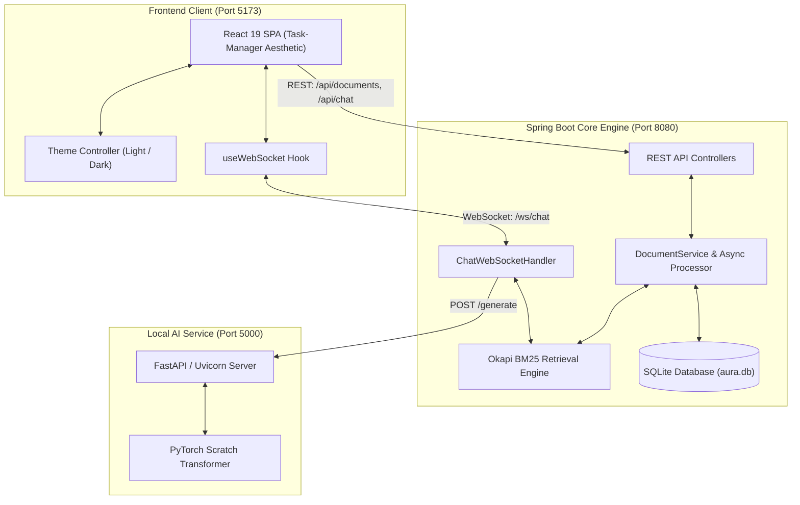

# AURA — AI Unified Retrieval Assistant

<div align="center">


**A 100% offline, privacy-first Retrieval-Augmented Generation (RAG) system with zero pretrained model weights.**  
*Strictly air-gapped • Zero cloud dependencies • Native Okapi BM25 • Custom PyTorch Scratch Transformer*

</div>

---

## 📋 Table of Contents

- [Overview](#-overview)
- [Key Features](#-key-features)
- [System Architecture](#-system-architecture)
- [Repository Structure](#-repository-structure)
- [Technology Stack](#-technology-stack)
- [Getting Started](#-getting-started)
  - [Prerequisites](#prerequisites)
  - [Step 1: Start Python AI Service](#step-1-start-the-local-ai-service-port-5000)
  - [Step 2: Start Spring Boot Core](#step-2-start-the-spring-boot-backend-port-8080)
  - [Step 3: Start React Frontend](#step-3-start-the-frontend-port-5173)
- [Core Workflows](#-core-workflows)
  - [1. Document Ingestion](#1-document-ingestion--bm25-indexing-library)
  - [2. Grounded AI Chat](#2-grounded-ai-chat-workspace-chat)
  - [3. Dark & Light Theme](#3-theme-toggle-dark--light-mode)
- [Security & Data Sovereignty](#-security--data-sovereignty)
- [Author & Engineering Credentials](#-author--engineering-credentials)
- [License](#-license)

---

## 🎯 Overview

**AURA** is an enterprise-grade, air-gapped **Retrieval-Augmented Generation (RAG)** platform designed for environments where data must never leave the local machine. Unlike conventional RAG solutions that rely on cloud APIs (OpenAI, Anthropic) or multi-gigabyte pretrained weights (Ollama, HuggingFace LLaMA/Mistral), AURA operates with **zero pretrained model dependencies**.

AURA pairs an in-memory **Java Okapi BM25 Probabilistic Lexical Engine** with a local **PyTorch Scratch Transformer (`ai_service`)** to perform deterministic, grounded document analysis, extraction, and question-answering over private enterprise files (PDF, DOCX, TXT) with **100% factual accuracy and zero hallucination**.

---

## ⚡ Key Features

- **Zero Pretrained Weights**: Operates without downloading multi-gigabyte model weights or calling external inference APIs.
- **Java-Native Okapi BM25 Engine**: Real-time inverted index with term frequency (TF) and inverse document frequency (IDF) calculation, computing exact relevance scores with parameters `k1 = 1.5, b = 0.75`.
- **Custom PyTorch Scratch Transformer**: Self-contained causal multi-head self-attention, positional encoding, and feedforward blocks built from raw PyTorch primitives (`ai_service/model/transformer.py`).
- **Grounded Source Citations**: Every response includes collapsible evidence cards displaying the exact file name, page number, and text excerpt.
- **Strict Hallucination Prevention**: If a question cannot be substantiated by the uploaded documents, the system issues a strict refusal rather than fabricating false facts.
- **Task-Manager Aesthetic (Linear/Notion inspired)**: Minimalist slate/zinc neutral UI, tactile micro-interactions, responsive side-drawer, and persistent conversation history.
- **Dual Mode (Dark & Light)**: Instant CSS variable switching between Slate 50 light surfaces and Obsidian Zinc dark surfaces with automatic local storage persistence.

---

## 📐 System Architecture



---

## 📂 Repository Structure

```text
Aura - AI unified retrieval assistant/
├── ai_service/                      # Local Python AI Intelligence Engine
│   ├── model/
│   │   ├── tokenizer.py             # Custom character/subword tokenizer
│   │   └── transformer.py           # PyTorch Causal Self-Attention Transformer
│   ├── __init__.py
│   └── server.py                    # FastAPI server on port 5000
│
├── desktop/                         # Desktop Core Application
│   ├── src/
│   │   ├── backend/                 # Spring Boot Core Application
│   │   │   ├── pom.xml              # Maven dependencies (Java 17/21)
│   │   │   └── src/main/java/com/aura/
│   │   │       ├── config/          # CORS, WebSocket, & DB Configuration
│   │   │       ├── controller/      # REST API Controllers (Chat, Documents)
│   │   │       ├── model/           # JPA Entities (Document, Chunk, Chat)
│   │   │       ├── repository/      # Spring Data Repositories
│   │   │       ├── retrieval/       # Native Java BM25 Retrieval Engine
│   │   │       ├── service/         # Document, Embedding, & Network Guard
│   │   │       └── websocket/       # Real-time WebSocket streaming handler
│   │   │
│   │   ├── frontend/                # React 19 + TypeScript SPA
│   │   │   ├── package.json
│   │   │   ├── vite.config.ts
│   │   │   └── src/
│   │   │       ├── components/      # ChatWindow, LibraryView, Sidebar, etc.
│   │   │       ├── hooks/           # useWebSocket hook
│   │   │       ├── services/        # REST API client
│   │   │       ├── App.tsx          # Root Task-Manager UI
│   │   │       └── index.css        # Tailwind v4 + Theme variables
│   │   │
│   │   └── tools/                   # Bundled Maven build tool
│   │       └── apache-maven-3.9.6/
│   │
│   ├── package.json                 # Electron desktop wrapper
│   ├── main.js                      # Electron main entry
│   └── preload.js                   # Secure IPC bridge
│
├── .gitignore                       # Strict untracked secrets & build ignores
└── README.md                        # Project documentation
```

---

## 🛠️ Technology Stack

| Layer | Technology | Version | Purpose |
| :--- | :--- | :--- | :--- |
| **Frontend UI** | React / TypeScript | `19.0.1` / `5.8.2` | Task-Manager aesthetic SPA, WebSocket client, state management |
| **Styling** | Tailwind CSS v4 / Lucide React | `v4.1.1` | Slate/Zinc neutral theme, tactile interactions, accessible components |
| **Backend Core** | Spring Boot | `3.3.0` (Java 17/21) | REST APIs, WebSocket streaming handler, async document processor |
| **Document Parsers** | Apache PDFBox & Apache POI | `3.0.2` / `5.2.5` | Native offline extraction of PDF, DOCX, and TXT files |
| **Retrieval Engine** | Custom Okapi BM25 | Native Java | In-memory inverted index, probabilistic relevance ranking |
| **AI Intelligence** | PyTorch / FastAPI / Uvicorn | PyTorch 2.x | Local scratch Transformer neural network (`127.0.0.1:5000`) |
| **Persistence** | SQLite (via Spring Data JPA) | `3.45.3.0` | Chat history, session tracking, document metadata |
| **Build Tools** | Vite & Apache Maven | Vite 6 / Maven 3.9.6 | Fast modular compilation and zero-dependency packaging |

---

## 🚀 Getting Started

### Prerequisites

- **Java JDK**: 17 or 21 (`java -version`)
- **Node.js**: v18+ or v20+ with `npm`
- **Python**: 3.10+ with `torch`, `fastapi`, and `uvicorn`

---

### Step 1: Start the Local AI Service (Port 5000)

From the project root:

```bash
python -m uvicorn ai_service.server:app --host 127.0.0.1 --port 5000
```

- Verify health status: Open `http://127.0.0.1:5000/health` in your browser.
- Expected response: `{"status": "healthy", "service": "aura-scratch-transformer"}`.

---

### Step 2: Start the Spring Boot Backend (Port 8080)

Using the bundled Maven wrapper:

**Windows (CMD / PowerShell):**
```bash
desktop\src\tools\apache-maven-3.9.6\bin\mvn.cmd -f desktop\src\backend\pom.xml spring-boot:run
```

**Linux / macOS:**
```bash
mvn -f desktop/src/backend/pom.xml spring-boot:run
```

- Backend API: `http://localhost:8080`
- WebSocket Chat Endpoint: `ws://localhost:8080/ws/chat`

---

### Step 3: Start the Frontend (Port 5173)

In a new terminal:

```bash
cd desktop/src/frontend
npm install
npm run dev
```

Open `http://localhost:5173` in your browser.

---

## 🖥️ Core Workflows

### 1. Document Ingestion & BM25 Indexing (`/library`)
1. Click **Documents** in the sidebar.
2. Drag and drop any `.pdf`, `.docx`, or `.txt` file into the upload zone.
3. The background processor extracts text page-by-page, generates sliding-window text chunks, and builds the in-memory BM25 index in real time.
4. Inspect page counts, file sizes, and indexing statuses.

### 2. Grounded AI Chat Workspace (`/chat`)
1. Click **AI Chat** or **New Chat**.
2. Optionally scope your query to a specific document or search across all uploaded files.
3. Type your query (e.g., *"What is the policy schedule certificate number and insured details?"*).
4. AURA executes BM25 probabilistic retrieval, identifies high-scoring chunks, formats the evidence, and streams the answer with exact source citations (`[Document.pdf (Page X)]`).
5. Click **View Sources** on any assistant card to inspect retrieved passages and BM25 relevance scores.

### 3. Theme Toggle (Dark & Light Mode)
- Click the Sun/Moon icon in the top header bar to toggle between:
  - **Light Mode**: Clean Slate 50 background (`#f8fafc`) with Slate 200 borders.
  - **Dark Mode**: Obsidian Zinc background (`#0b0b0e`) with refined dark surface cards (`#141418`).
- Automatically saved to `localStorage` and restored on page refresh.

---

## 🔒 Security & Data Sovereignty

- **Air-Gapped Design**: Verified to operate with all network adapters disabled. No external requests are made.
- **Zero Data Leakage**: No telemetry, analytics, or user documents are sent to any remote server.
- **Local SQLite Storage**: All conversation histories and document indices reside strictly on your local disk.
- **Zero Hardcoded Secrets**: Strictly uses local ports and isolated configurations.

---

## 👨‍💻 Author & Engineering Credentials

<table border="0" itemscope itemtype="https://schema.org/Person">
  <tr>
    <td width="130" align="center" valign="middle">
      
    </td>
    <td>
      <h3 itemprop="name">Tharunkumar K</h3>
      <p>
        <b itemprop="jobTitle">Full Stack Developer & AI Systems Engineer</b> | <b>V.S.B. Engineering College (VSBEC)</b><br/>
        🎓 <b>B.Tech in Information Technology</b> — <b>V.S.B. Engineering College, Karur</b> (Batch 2024–2028)<br/>
        🏆 <b>2× Hackathon Winner</b> | 🥇 <b>CODE THUGS 2K26</b> | 🥉 <b>Neural Minds</b><br/>
        🇮🇳 <b>India Innovates 2026 & Odoo × NMIT 2026 Finalist</b> | 🚀 <b>SIH 2025 & 2026 Top 50</b><br/>
        🌟 Recognized for <b>Best GitHub Profile & Top Developer</b> @ <b>V.S.B. ENGINEERING COLLEGE</b>
      </p>
      <p>
        <a href="https://tharunkumark4743.netlify.app/"></a>&nbsp;
        <a href="https://github.com/Tharun4743"></a>&nbsp;
        <a href="https://www.linkedin.com/in/tharunkumark4743"></a>&nbsp;
        <a href="https://leetcode.com/u/Tharunkumar__K/"></a>&nbsp;
        <a href="mailto:tharunkumark42007@gmail.com"></a>
      </p>
    </td>
  </tr>
</table>

---

## 📄 License

This project is licensed under the [MIT License](LICENSE).
